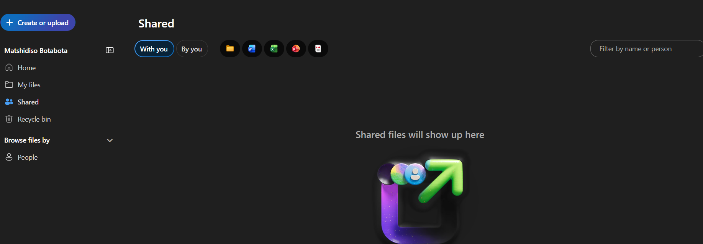

# Microsoft OneDrive - IT Support Guide

## Overview

Microsoft OneDrive is a cloud storage service that allows users to store, access, synchronise, and share files across supported devices.

IT support technicians help users resolve synchronisation problems, locate missing files, manage sharing access, and understand common OneDrive errors.

## 1. Accessing OneDrive

Users can access OneDrive through a web browser or the synchronisation application installed on their device.

**Procedure:**

1. Open [OneDrive](https://www.microsoft365.com/).
2. Sign in using the appropriate Microsoft account.
3. Open OneDrive from the available applications.
4. Confirm that the expected files and folders are visible.

**Support note:** Work or school OneDrive accounts are managed according to the organisation's licence, storage policies, and access permissions.

## 2. Common OneDrive Tasks

### Uploading a file

1. Open OneDrive.
2. Navigate to the destination folder.
3. Select **Upload** and choose the file, or use the available drag-and-drop option.
4. Wait for the upload to finish.
5. Confirm that the file appears in the destination folder.

**Support tip:** If an upload fails, check the connection, available storage, file restrictions, and any displayed error message.

### Sharing a file

1. Select the file or folder.
2. Choose **Share**.
3. Review the available sharing options.
4. Select an appropriate access level according to organisational policy.
5. Enter the intended recipients or create an approved sharing link.
6. Send the invitation or link.
7. Confirm that the intended recipient can access the file.

**Security note:** Use the minimum access required. Do not create public links for confidential information unless explicitly permitted by organisational policy.

### Checking synchronisation status

1. Locate the OneDrive cloud icon in the device's notification area or menu bar.
2. Open OneDrive to review its synchronisation status.
3. Check for error messages or files awaiting synchronisation.
4. Confirm that the affected file appears in OneDrive on the web, where appropriate.

**Support tip:** A file appearing on one device does not necessarily mean that it has synchronised successfully to the cloud.

## 3. Troubleshooting Common OneDrive Issues

### Issue 1: Files are not synchronising

**Possible causes:**

* The device is offline or has an unstable connection.
* OneDrive is paused or signed out.
* The file is open in an application that prevents the required operation.
* A file or folder name violates applicable restrictions.
* Available storage is insufficient.
* OneDrive has reported a synchronisation error.

**Troubleshooting steps:**

1. Confirm that the device has a working internet connection.
2. Open OneDrive and check whether synchronisation is paused.
3. Confirm that the user is signed in to the correct account.
4. Review any displayed synchronisation errors.
5. Check the file name, path, and applicable file restrictions.
6. Confirm that sufficient storage is available.
7. Resume synchronisation if it was paused and the user is authorised to do so.
8. Check OneDrive on the web to determine whether the latest version is available online.

**Verification:** Confirm that the file appears in the expected location and that the synchronisation status indicates successful completion.

### Issue 2: A file appears to be missing

**Possible causes:**

* The file was moved or renamed.
* The user is viewing the wrong account or folder.
* The file is in the recycle bin.
* The file has not synchronised.
* The user no longer has access to the file.
* Another user moved or deleted a shared file.

**Troubleshooting steps:**

1. Confirm the account and location where the file was originally saved.
2. Search OneDrive for the file name.
3. Check relevant folders and the recycle bin, subject to organisational policy.
4. If the file was shared, confirm that the sharing permissions are still valid.
5. Check whether the file exists on another authorised device or in the web interface.
6. If necessary, escalate recovery or access requests to an authorised administrator.

**Verification:** Confirm that the file has been located or that the recovery request has been escalated.

**Important:** Avoid creating multiple replacement copies or deleting files while investigating. This may complicate recovery or version tracking.

### Issue 3: A user cannot access a shared file

**Possible causes:**

* The user is signed in with the wrong account.
* The sharing link has expired or is invalid.
* The file owner changed the permissions.
* The organisation restricts external sharing.
* The file or folder has been moved or deleted.

**Troubleshooting steps:**

1. Record the error message and identify the affected file or folder.
2. Confirm which account the recipient is using.
3. Ask the file owner to verify that the intended recipient has access.
4. Check whether the link is still valid.
5. Confirm whether organisational sharing restrictions apply.
6. Request an authorised owner or administrator to correct permissions where necessary.

**Verification:** Confirm that the intended user can open the file with the appropriate access level.

### Issue 4: OneDrive reports that storage is full

**Possible causes:**

* The user's storage quota has been reached.
* Large files are consuming available space.
* The recycle bin is using storage under the applicable service rules.
* An organisational storage policy is limiting available capacity.

**Troubleshooting steps:**

1. Review the available storage information in OneDrive.
2. Identify large or unnecessary files in accordance with the user's retention requirements.
3. Confirm whether the recycle bin or other storage locations contribute to the issue.
4. Do not permanently delete business files without the appropriate authorisation.
5. If additional capacity or a quota change is required, escalate to the relevant administrator.

**Verification:** Confirm that sufficient storage is available and that the affected upload or synchronisation operation can complete.

## 4. Information to Record During Troubleshooting

Document the following using approved support procedures:

* Affected user or support-ticket identifier.
* Date and approximate time of the issue.
* File or folder location, without copying confidential content into the ticket unnecessarily.
* Exact error message and synchronisation status.
* Whether the problem affects one file, multiple files, or multiple users.
* Troubleshooting steps and results.
* Resolution or escalation details.

Never request a user's password or record authentication codes.

## 5. When to Escalate

Escalate when:

* File recovery requires administrative intervention.
* Sharing permissions cannot be corrected by the file owner.
* Multiple users experience synchronisation failures.
* Storage quotas or organisational policies require changes.
* Files may have been deleted, exposed, or accessed without authorisation.

Follow organisational incident and data-protection procedures when a possible security incident is identified.

## 6. Official Microsoft Resources

* [Microsoft OneDrive](https://www.microsoft365.com/)
* [OneDrive help and learning](https://support.microsoft.com/onedrive)
* [OneDrive troubleshooting](https://support.microsoft.com/search/results?query=OneDrive%20sync%20troubleshooting)

## Document Information

* **Category:** IT Support Documentation
* **Audience:** IT support technicians
* **Status:** Initial draft
* **Last reviewed:** October 2026
