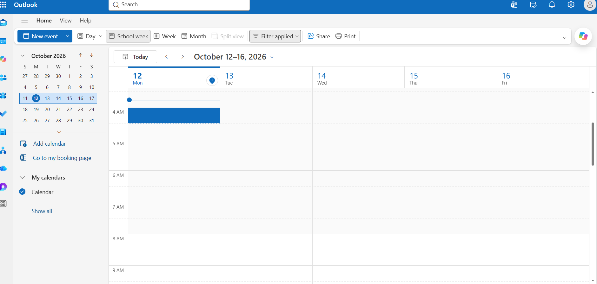

# Microsoft Outlook – User Support Guide

## 1. Overview

Microsoft Outlook is an email and personal information management application used by organisations to manage business communication, calendars, meetings and contacts.

As an IT Support Technician, understanding Outlook is important because email-related issues are among the common requests received by helpdesk teams.

This guide covers basic Outlook functionality, user support procedures and common troubleshooting scenarios.

## 2. Key Features

| Feature | Description |
|---|---|
| Email Management | Send, receive, organise and manage emails. |
| Calendar | Schedule appointments and manage events. |
| Meetings | Create and respond to meeting invitations. |
| Contacts | Store and manage contact information. |
| Attachments | Send and receive files through email. |
| Search | Find emails, contacts and calendar items. |

## 3. Basic User Support

### 3.1 Sending and Receiving Emails

Users can send emails, reply to messages, forward emails and manage incoming messages.

**Basic support procedure:**

1. Open Outlook.
2. Navigate to the Inbox.
3. Select New Mail.
4. Enter the recipient's email address.
5. Add a subject and message.
6. Attach files if required.
7. Select Send.

**Helpdesk considerations:**

- Confirm that the recipient's email address is correct.
- Check whether the message is saved in Drafts or Outbox.
- Investigate connectivity issues if messages are not synchronising.
- Check for delivery failure notifications.

### 3.2 Managing the Calendar

Outlook Calendar allows employees to schedule appointments, organise meetings and manage their availability.

**Basic support procedure:**

1. Open the Calendar section.
2. Select New Event.
3. Enter the event title.
4. Select the date and time.
5. Add participants if required.
6. Save or send the invitation.

**Helpdesk considerations:**

- Verify the meeting date and time.
- Check calendar permissions where applicable.
- Investigate missing meeting invitations.
- Check time zone settings if meeting times appear incorrect.

### 3.3 Managing Email Attachments

Outlook allows users to attach files to outgoing messages and access files received from other users.

**Helpdesk considerations:**

- Confirm that the attachment is included before sending.
- Check file size restrictions.
- Investigate unsupported file types.
- Consider secure file-sharing alternatives for large files.

## 4. Common Outlook Issues and Troubleshooting

### Issue 1: Outlook Is Not Sending or Receiving Emails

**Possible causes:**
- Internet connectivity problems.
- Incorrect account configuration.
- Temporary service interruptions.
- Mailbox storage limitations.

**Troubleshooting procedure:**

1. Check whether the computer has an active internet connection.
2. Test whether other websites and applications are accessible.
3. Check Outlook for connection or synchronisation errors.
4. Verify whether the issue affects sending, receiving or both.
5. Check Microsoft 365 service health if administrative access is available.
6. Retry sending or receiving a test email.
7. Escalate if the issue persists.

### Issue 2: Outlook Cannot Sign In

**Possible causes:**
- Incorrect username.
- Incorrect or outdated credentials.
- Account restrictions.
- Multifactor authentication problems.

**Troubleshooting procedure:**

1. Confirm that the user is using the correct organisational email address.
2. Check whether the user can access other Microsoft 365 services.
3. Review any error messages displayed.
4. Verify account status through the appropriate administrative channel, where available.
5. Follow the organisation's approved password-reset or account-recovery procedure.
6. Escalate unresolved authentication issues.

**Security note:** Never request or record an employee's password.

### Issue 3: Outlook Is Running Slowly

**Possible causes:**
- Poor internet connectivity.
- Large mailbox size.
- Excessive cached data.
- Outdated application.
- Problematic add-ins.

**Troubleshooting procedure:**

1. Check the computer's overall performance.
2. Determine whether the issue occurs in Outlook only.
3. Check for available Office updates.
4. Test Outlook on the web, if available.
5. Investigate add-ins if using classic Outlook.
6. Escalate if performance remains poor.

### Issue 4: Outlook Is Not Synchronising

**Possible causes:**
- Network connectivity problems.
- Account synchronisation errors.
- Application configuration issues.
- Temporary service interruptions.

**Troubleshooting procedure:**

1. Confirm that the device has internet access.
2. Check the last successful synchronisation.
3. Compare the mailbox in Outlook with Outlook on the web, if available.
4. Review any synchronisation error messages.
5. Investigate account configuration.
6. Confirm whether new messages are synchronising.

## 5. Practical Helpdesk Scenarios

The following scenarios are used to practise structured incident investigation.

### Scenario 1: Employee Cannot Send Emails

**Reported problem:** A Finance employee reports that emails remain in the Outbox.

**Initial investigation:**
- Check internet connectivity.
- Review the Outbox for pending messages.
- Check for error notifications.
- Determine whether the problem affects all recipients.

**Expected outcome:** Identify the cause, apply an appropriate resolution and confirm that the employee can send a test email.

### Scenario 2: Employee Cannot Access Outlook

**Reported problem:** A Sales employee cannot sign in to their Outlook account.

**Initial investigation:**
- Verify the organisational username.
- Review the displayed authentication error.
- Check whether other Microsoft 365 services are accessible.
- Investigate account access through the appropriate administrative process.

**Expected outcome:** Identify whether the problem relates to credentials, authentication or account status.

### Scenario 3: Employee Is Not Receiving Meeting Invitations

**Reported problem:** An employee reports that scheduled meeting invitations are not appearing in Outlook.

**Initial investigation:**
- Confirm the meeting organiser and recipient address.
- Check the Inbox, Junk Email and Deleted Items folders.
- Review calendar settings.
- Determine whether other employees are experiencing the same issue.

**Expected outcome:** Identify the reason for the missing invitations and verify that meeting notifications are working.

## 6. IT Support Best Practices

- Protect employee account credentials.
- Verify the user's identity before making account changes.
- Document troubleshooting steps and resolutions.
- Avoid unnecessary changes to account configurations.
- Keep Outlook applications updated.
- Escalate issues requiring administrative privileges.
- Confirm that the user can access the service before closing an incident.

## 7. Knowledge and Skills Demonstrated

Through this guide, I demonstrate an understanding of:

- Email and calendar support.
- Basic Outlook configuration concepts.
- Email delivery and synchronisation troubleshooting.
- Account access investigation.
- Structured incident diagnosis.
- User communication and technical documentation.

---

**Application:** Microsoft Outlook  
**Category:** Microsoft 365 User Support  
**Project:** Microsoft 365 Helpdesk Lab
