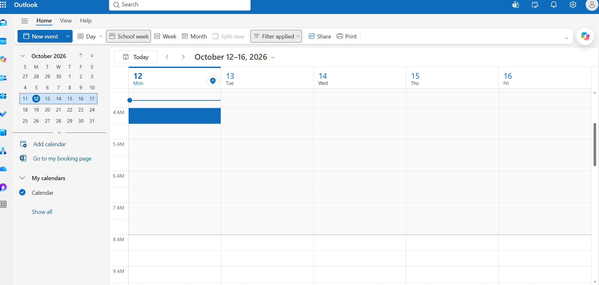

# Microsoft Outlook - IT Support Guide

## Overview

Microsoft Outlook is an email and calendar application used to communicate, organise meetings, and manage contacts. It is available through the web and supported desktop and mobile applications.

This guide covers common Outlook tasks and first-line troubleshooting procedures for IT support technicians.

## 1. Accessing Outlook

Users can access Outlook on the web through Microsoft 365.

**Procedure:**

1. Open a web browser.
2. Navigate to [Outlook](https://outlook.office.com/).
3. Sign in using the appropriate Microsoft account.
4. Complete any required authentication.
5. Confirm that the mailbox and calendar are accessible.

**Support note:** Access depends on the account, assigned licence, permissions, and organisational configuration.

## 2. Common Outlook Tasks

### Sending an email

1. Select **New mail**.
2. Enter the recipient's email address.
3. Add a clear subject.
4. Write the message.
5. Attach files if required and appropriate.
6. Review the recipients and message, then select **Send**.

**Support tip:** If a recipient does not receive an email, check the Sent Items folder, any delivery or error notifications, and whether the message is in Drafts or Outbox.

### Managing the calendar

1. Open **Calendar** in Outlook.
2. Select **New event**.
3. Enter the event title, date, and time.
4. Add attendees if needed.
5. Review the meeting details and select **Send** or **Save**, as applicable.

**Support tip:** When investigating a missing meeting, confirm the date range, calendar selected, meeting organiser, and whether the invitation was accepted or updated.

### Managing attachments

1. Open the relevant email.
2. Locate the attachment.
3. Confirm that the file is expected and from a trusted sender.
4. Preview or download it using the available options.
5. Follow organisational security policies before opening or sharing the file.

**Security note:** Never encourage users to open unexpected attachments simply because they appear to come from a familiar sender.

## 3. Troubleshooting Common Outlook Issues

### Issue 1: Outlook cannot be accessed

**Possible causes:**

* Sign-in or authentication problems.
* Incorrect account selection.
* Browser session issues.
* Mailbox permissions or licensing problems.
* A Microsoft 365 service disruption.

**Troubleshooting steps:**

1. Record the exact error message.
2. Check whether the user can access other Microsoft 365 services.
3. Try accessing Outlook on the web at [outlook.office.com](https://outlook.office.com/).
4. If permitted, try a private browser window to check for a browser-session issue.
5. Check relevant service health information if authorised.
6. Escalate persistent sign-in, mailbox, or licensing issues to the appropriate administrator.

**Verification:** Confirm that the user can open the mailbox and access the required features.

### Issue 2: Emails are not being received

**Possible causes:**

* Messages are in Junk Email or another folder.
* An inbox rule has moved the messages.
* The sender used an incorrect address.
* The mailbox has a storage or organisational restriction.
* A mail-flow or service issue exists.

**Troubleshooting steps:**

1. Ask the user for the sender, approximate time, and subject of the missing message.
2. Search the mailbox and check Junk Email, Deleted Items, and other relevant folders.
3. Review inbox rules and forwarding settings where authorised.
4. Ask the sender to confirm the recipient address and check for a delivery failure notification.
5. If the issue persists, escalate for message-trace or mail-flow investigation by an authorised administrator.

**Verification:** Confirm that the expected message is available or that the cause has been identified for further investigation.

### Issue 3: Emails are stuck in the Outbox

**Possible causes:**

* Network connectivity problems.
* An attachment that exceeds an applicable limit.
* A temporary application or service issue.
* An account or sending restriction.

**Troubleshooting steps:**

1. Confirm that the device has an internet connection.
2. Check whether Outlook displays a connection or sending error.
3. Open the Outbox and inspect the affected message.
4. Check the attachment size and applicable organisational limits.
5. If using desktop Outlook, check whether Work Offline is enabled.
6. Retry sending when connectivity is restored.
7. If the message remains unsent, record the error and escalate as necessary.

**Verification:** Confirm that the message leaves the Outbox and appears in Sent Items.

### Issue 4: Outlook is slow or unresponsive

**Possible causes:**

* A temporary application or browser issue.
* Network performance problems.
* Large mail folders or mailbox-related issues.
* Desktop add-ins or application configuration problems.

**Troubleshooting steps:**

1. Determine whether the issue occurs in Outlook on the web, the desktop application, or both.
2. Check the device's network connection and overall performance.
3. If using Outlook on the web, refresh the page and test a supported browser.
4. If using desktop Outlook, restart the application and check for available updates according to organisational policy.
5. If the problem persists, collect the error details and escalate for further diagnosis.

**Verification:** Confirm whether Outlook responds normally and whether the issue is resolved or isolated to a specific environment.

## 4. Information to Record During Troubleshooting

Document the following information in accordance with organisational procedures:

* Affected user and service, using approved support-ticket identifiers.
* Date and approximate time of the issue.
* Exact error message or observed symptoms.
* Whether the issue affects one user or multiple users.
* Troubleshooting steps performed and their results.
* Resolution, outstanding actions, or escalation details.

Never include passwords, authentication codes, or unnecessary personal information in support notes.

## 5. When to Escalate

Escalate when:

* Mailbox access or permissions require administrator intervention.
* Multiple users experience similar sending or receiving failures.
* Message delivery requires an administrative message trace.
* A suspected service disruption affects Outlook.
* Basic troubleshooting does not resolve the issue.

## 6. Official Microsoft Resources

* [Outlook on the web](https://outlook.office.com/)
* [Microsoft Outlook help](https://support.microsoft.com/outlook)
* [Microsoft 365 troubleshooting](https://learn.microsoft.com/en-us/troubleshoot/microsoft-365-apps/)

## Document Information

* **Category:** IT Support Documentation
* **Audience:** IT support technicians
* **Status:** Initial draft
* **Last reviewed:** October 2026

