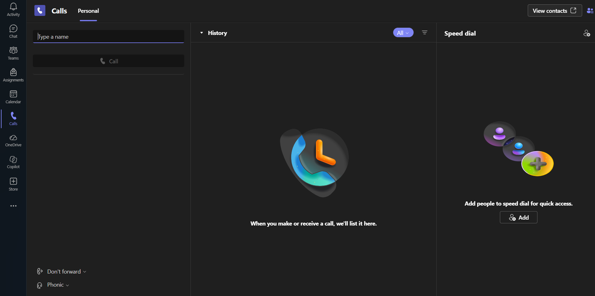

# Microsoft Teams - IT Support Guide

## Overview

Microsoft Teams is a collaboration application used for workplace messaging, meetings, calls, and file sharing. IT support technicians help users access Teams, resolve connectivity problems, and troubleshoot common meeting and messaging issues.

This guide covers common tasks, first-line troubleshooting, verification, and escalation.

## 1. Accessing Microsoft Teams

Users can access Teams through a supported web browser or the desktop and mobile applications.

**Procedure:**

1. Open [Microsoft Teams](https://teams.microsoft.com/).
2. Sign in using the appropriate work or school account.
3. Complete any required authentication.
4. Confirm that the Teams interface loads.
5. Check that the user can access the required teams, chats, or meetings.

**Support note:** Available features depend on the user's account, licence, permissions, and organisational configuration.

## 2. Common Microsoft Teams Tasks

### Sending a message

1. Open **Chat**.
2. Select an existing conversation or start a new chat.
3. Enter the recipient's name or address.
4. Type the message and select **Send**.

**Support tip:** If a message is not delivered, confirm the recipient, check connectivity, and determine whether the problem affects one conversation or multiple chats.

### Joining a meeting

1. Open the meeting invitation or Teams calendar.
2. Select the meeting.
3. Check the camera and microphone settings.
4. Select **Join**.
5. Confirm that the meeting opens successfully.

**Support tip:** If the user cannot join, record the error message and check the meeting link, account being used, and applicable meeting access restrictions.

### Sharing a file

1. Open the relevant chat or channel.
2. Select the file attachment option.
3. Choose the file or an available sharing option.
4. Confirm that the intended recipients have the necessary access.
5. Ask the recipient to verify that the file opens.

**Security note:** Follow organisational policies when sharing confidential files. Access to a file may depend on its storage location and sharing permissions.

## 3. Troubleshooting Common Teams Issues

### Issue 1: Teams sign-in failure

**Possible causes:**

* Incorrect account selection.
* Authentication or account restrictions.
* Browser session problems.
* Network connectivity issues.
* A Microsoft 365 service disruption.

**Troubleshooting steps:**

1. Record the exact error message and when it occurred.
2. Confirm that the user is signing in with the correct work or school account.
3. Check whether other Microsoft 365 services are accessible.
4. If permitted, try Teams on the web or a private browser window to help isolate a browser-session issue.
5. Check relevant service health information if authorised.
6. Escalate persistent authentication or account-policy problems to the appropriate administrator.

**Verification:** Confirm that Teams opens and the user can access the required features.

### Issue 2: Microphone or camera not working

**Possible causes:**

* Incorrect device selected in Teams.
* Operating-system privacy permissions.
* Another application using the device.
* Outdated drivers or application issues.
* Hardware or connection problems.

**Troubleshooting steps:**

1. Confirm that the microphone or camera is connected and switched on.
2. Open Teams settings and check the selected microphone, speaker, and camera.
3. Use the available test feature, if provided.
4. Check the operating system's privacy settings and allow Teams to access the required devices.
5. Close other applications that may be using the microphone or camera.
6. Restart Teams and test again.
7. If the issue persists, test the device with an approved alternative application and escalate if necessary.

**Verification:** Confirm that the user can hear meeting audio and that the microphone and camera work as expected.

### Issue 3: Poor call quality or connection problems

**Possible causes:**

* Unstable internet connectivity.
* Weak Wi-Fi signal.
* High network usage.
* VPN or firewall restrictions.
* A service-side issue.

**Troubleshooting steps:**

1. Determine whether the issue affects Teams only or other online services as well.
2. Check the user's internet connection.
3. If permitted, test with a more stable network connection.
4. Check whether the issue affects one meeting or multiple calls.
5. Record the time, symptoms, and any displayed connection warnings.
6. Escalate persistent problems that may require network or service investigation.

**Verification:** Confirm whether audio and video quality improve and whether the user can participate reliably.

### Issue 4: Teams notifications are missing

**Possible causes:**

* Notification settings are disabled.
* Operating-system notification permissions are restricted.
* The user has enabled Do Not Disturb or another status setting.
* The application is not running as expected.

**Troubleshooting steps:**

1. Review notification settings in Teams.
2. Check the operating system's notification permissions.
3. Confirm the user's availability status and relevant quiet-hour settings.
4. Check whether notifications are missing for all chats or only specific conversations.
5. Restart Teams and send a test message.

**Verification:** Confirm that the expected notification appears.

## 4. Information to Record During Troubleshooting

Document the following in accordance with organisational procedures:

* Affected user or approved support-ticket identifier.
* Date and approximate time of the issue.
* Exact error message and observed symptoms.
* Whether the issue affects one user or multiple users.
* Device, application, and network details relevant to the issue.
* Troubleshooting steps completed and their results.
* Resolution or escalation details.

Do not record passwords, authentication codes, or unnecessary personal information.

## 5. When to Escalate

Escalate when:

* Account access requires administrator intervention.
* Multiple users experience the same service issue.
* Audio or video problems persist after basic device checks.
* Network, firewall, or organisational policies may be involved.
* The issue requires administrative diagnostics or changes.

## 6. Official Microsoft Resources

* [Microsoft Teams](https://teams.microsoft.com/)
* [Microsoft Teams help and learning](https://support.microsoft.com/teams)
* [Microsoft Teams troubleshooting documentation](https://learn.microsoft.com/en-us/troubleshoot/microsoftteams/)

## Document Information

* **Category:** IT Support Documentation
* **Audience:** IT support technicians
* **Status:** Initial draft
* **Last reviewed:** October 2026
